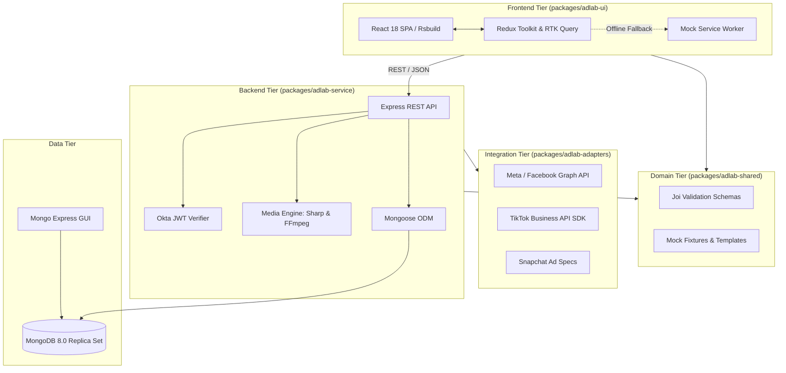

# AdLab 🎯

[](https://nodejs.org/)
[](https://pnpm.io/)
[](https://nx.dev/)
[](https://react.dev/)
[](https://expressjs.com/)
[](https://www.mongodb.com/)
[](https://www.docker.com/)
[](LICENSE)

> **AdLab** is a full-stack Dynamic Creative Optimization (DCO) and ad campaign orchestration platform. It empowers marketing teams, creative agencies, and performance engineers to compose, personalize, and publish dynamic ad variants across multiple advertising networks (Meta, TikTok, Snapchat) with real-time rule decisioning.

---

## 🏛️ System Architecture



---

## 📦 Packages Breakdown

AdLab is organized as a high-performance monorepo managed with **Nx** and **pnpm workspaces**:

| Package | Directory | Description | Primary Technologies |
|---|---|---|---|
| **`adlab-ui`** | [`packages/adlab-ui`](packages/adlab-ui/) | Single Page Application dashboard for campaign management, creative matrix combo builder, and real-time previews. | React 18, Rsbuild, Redux Toolkit, Emotion, Sass, Playwright |
| **`adlab-service`** | [`packages/adlab-service`](packages/adlab-service/) | Node.js backend handling REST APIs, asset ingestion, image/video transcoding, and MongoDB migrations. | Node.js, Express, Mongoose, Sharp, Fluent-FFmpeg, migrate-mongo |
| **`adlab-adapters`** | [`packages/adlab-adapters`](packages/adlab-adapters/) | Pluggable ad network adapter layer communicating with external ad platform APIs. | TikTok Business API SDK, Axios, Form-Data, Joi |
| **`adlab-shared`** | [`packages/adlab-shared`](packages/adlab-shared/) | Shared domain models, Joi validation schemas, utility functions, and offline test fixtures. | Joi, Webpack ESM |

---

## ✨ Key Capabilities

1. **Multi-Channel Creative Orchestration**: Define campaigns once and export compliant creative sets formatted for Meta, TikTok, and Snapchat.
2. **Dynamic Creative Personalization (DCO)**: Build complex decisioning matrices with variables such as Day of Week, Time of Day, Weather, Geography, Audience Segment, and Device Type.
3. **High-Performance Media Engine**: Automated on-the-fly image optimization via **Sharp** and video transcoding / scaling via **Fluent-FFmpeg**.
4. **Resilient Local Mocking**: Develop and test offline seamlessly using Redux Toolkit error fallbacks and Mock Service Worker (MSW).
5. **Containerized Microservices**: One-click local deployment with Docker Compose, including a MongoDB 8.0 replica set and Mongo Express UI.

---

## 🚀 Quick Start

### Prerequisites

- **Node.js**: Version `20.17.0` (LTS) or higher
- **pnpm**: Version `9.0.0` or higher (`npm install -g pnpm` or `corepack enable`)
- **Docker & Docker Compose**: For containerized database and services

### 1. Clone & Install

```bash
git clone https://github.com/iporky/adlab.git
cd adlab
pnpm install
```

### 2. Environment Configuration

Copy the sample environment variables for the frontend:

```bash
cp packages/adlab-ui/.env.sample packages/adlab-ui/.env
```

Key environment configurations:

| Variable | Default | Purpose |
|---|---|---|
| `PUBLIC_API_SERVER_URL` | `http://localhost:8080` | Backend API URL |
| `PUBLIC_USE_PERSONALIZATION_MOCK_DATA` | `true` | Enables offline fallback mock data |
| `PUBLIC_ENABLE_MSW` | `false` | Enables client-side Mock Service Worker |
| `MONGODB_URL` | `mongodb://localhost:27017` | MongoDB connection string |

### 3. Launch with Docker Compose (Recommended)

Start all services (UI, Backend Service, MongoDB, and Mongo Express):

```bash
# Automated setup (installs deps, starts containers, onboards database)
pnpm run setup
```

Or step-by-step:

```bash
# 1. Start Docker containers
docker compose up -d

# 2. Run database migrations
pnpm run onboard:db
```

### Service Endpoints

Once running, the following endpoints are available:

| Service | URL | Notes |
|---|---|---|
| **AdLab UI** | [`http://localhost:3000/adlab`](http://localhost:3000/adlab) | Web Application Dashboard |
| **AdLab Service API** | [`http://localhost:8080`](http://localhost:8080) | Express Backend REST API |
| **Mongo Express GUI** | [`http://localhost:8081`](http://localhost:8081) | Database Management Client |
| **MongoDB** | `mongodb://localhost:27017` | Primary Database Replica |

---

## 🛠️ Monorepo CLI Commands

All workspace commands can be run from the root directory using `pnpm` and `nx`:

```bash
# Building Packages
pnpm run build              # Build all packages across the workspace
pnpm run build:ui           # Build adlab-ui with Rsbuild
pnpm run build:service      # Build adlab-service
pnpm run build:adapters     # Build adlab-adapters
pnpm run build:shared       # Build adlab-shared

# Testing & Quality
pnpm run test               # Run unit tests across all packages
pnpm run format             # Format all packages with Prettier / ESLint

# Database Migrations
pnpm run onboard:db         # Execute pending Mongo migrations (up)
pnpm run deboard:db         # Rollback last Mongo migration (down)
```

---

## 📌 Engineering Roadmap & Pending Tasks

We maintain an active tracking list of pending tasks, technical debt, and architecture milestones in our roadmap:

👉 See [**ROADMAP.md**](ROADMAP.md) for full details on:
- Monorepo lint/prettier consolidation
- Pre-commit Husky hooks
- Dependency optimization in `adlab-ui`
- Asynchronous video transcoding queue with Redis/BullMQ
- Google Ads & DV360 adapter integrations

---

## 🤝 Contributing

We welcome contributions! Please review [CONTRIBUTING.md](CONTRIBUTING.md) and use our [Pull Request Template](.github/pull_request_template.md).

1. Fork or branch from `main`
2. Create your feature branch (`git checkout -b feature/dynamic-creative-preview`)
3. Commit your changes (`git commit -m 'feat: add dynamic creative preview'`)
4. Push to branch (`git push origin feature/dynamic-creative-preview`)
5. Open a Pull Request

---

## 📄 License

This project is licensed under the [ISC License](LICENSE).
