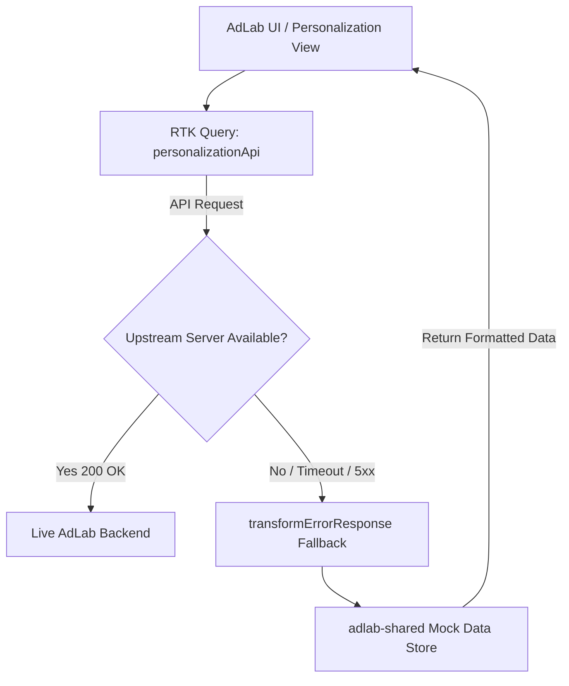

# Personalization Mock & Development System

## Overview

The AdLab Personalization engine enables marketers and media planners to define multi-dimensional audience segments, contextual rules (e.g., weather, dayparting, device, geography), and creative matrix combinations.

When developing locally or in environments where upstream marketing microservices / asset vaults are not directly reachable, the AdLab UI provides a resilient Mock Fallback System powered by Redux Toolkit Query (RTK Query) and Mock Service Worker (MSW).

---

## Architecture



---

## Configuration & Environment Flags

In `packages/adlab-ui/.env` (or `.env.sample`):

| Variable | Type | Default | Description |
|---|---|---|---|
| `PUBLIC_ENABLE_MSW` | Boolean | `false` | Enables client-side Service Worker API interception |
| `PUBLIC_USE_PERSONALIZATION_MOCK_DATA` | Boolean | `true` | Allows components to fall back gracefully to local fixture mocks |
| `PUBLIC_API_BASE_URL` | URL | `http://localhost:8080/v1` | Root URL for campaign and personalization endpoints |

---

## Mock Data Fixtures

Fixture data is centrally shared from the `adlab-shared` package:

- **Templates (`adlab-shared/src/mocks`)**: Pre-configured ad canvas formats (e.g., 300x250 Medium Rectangle, 970x250 Billboard, 1080x1920 Story / Vertical).
- **Folders & Assets (`adlab-shared/src/mocks/folders`)**: Mock creative asset library including images, logos, dynamic text tags, and call-to-action buttons.
- **Rule Definitions (`personalizationConstants.js`)**: Default decisioning dimensions including `dayofweek`, `timeofday`, `weather`, `season`, `location`, `segment`, `device`, and `geo`.

---

## How to Test Personalization Offline

1. Ensure `.env` in `packages/adlab-ui` contains:
   ```env
   PUBLIC_USE_PERSONALIZATION_MOCK_DATA=true
   ```
2. Start the development server:
   ```bash
   pnpm run dev
   # or with MSW enabled:
   pnpm run dev:msw
   ```
3. Navigate to `http://localhost:3000/adlab/campaign/personalization`.
4. If a live campaign ID is not present in the URL, create a new rule combination using the **Combo Builder** palette.
